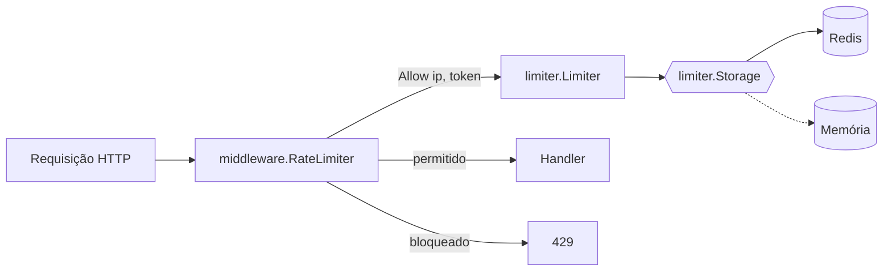

# Rate-Limiter

Rate Limiter em Go implementado como **middleware HTTP**, capaz de limitar requisições por **IP** ou por **Token de acesso** (header `API_KEY`), com persistência em **Redis** via padrão **Strategy**.

## Sumário

- [Como funciona](#como-funciona)
- [Arquitetura](#arquitetura)
- [Configuração](#configuração)
- [Executando o projeto](#executando-o-projeto)
- [Executando os testes](#executando-os-testes)
- [Trocando a estratégia de persistência](#trocando-a-estratégia-de-persistência)

## Como funciona

1. A cada requisição o middleware extrai o **IP** do cliente e o header **`API_KEY`**.
2. **Precedência (Token > IP):** se o token informado possuir limite configurado, o limite do token é aplicado (e o contador é por token), **sobrepondo** o limite por IP. Caso contrário, aplica-se o limite por IP.
3. Para a chave escolhida (`ip:<ip>` ou `token:<token>`):
   - se estiver **bloqueada**, a requisição é rejeitada;
   - senão, o contador da janela (1s por padrão) é incrementado atomicamente;
   - se o contador ultrapassar o limite, a chave é **bloqueada** pelo tempo configurado e a requisição é rejeitada.
4. Requisições rejeitadas recebem:
   - **HTTP 429**
   - corpo: `you have reached the maximum number of requests or actions allowed within a certain time frame`

Respostas também incluem os headers `X-RateLimit-Limit` e `X-RateLimit-Remaining`.

> Se a persistência ficar indisponível, o middleware registra o erro em log e deixa a requisição passar (*fail-open*), evitando que o rate limiter derrube o serviço.

## Arquitetura

```
cmd/server/main.go              # composição: config + storage + limiter + middleware + servidor
internal/
  config/                       # leitura de variáveis de ambiente / .env
  limiter/
    limiter.go                  # regra de negócio (independente de HTTP e de persistência)
    storage.go                  # interface Storage (Strategy)
  middleware/ratelimiter.go     # adaptador HTTP do limiter
  storage/
    redis/                      # Strategy Redis (padrão)
    memory/                     # Strategy em memória (exemplo de troca / testes)
```



- **Desacoplamento:** o middleware depende apenas da interface `Allower`; o `Limiter` depende apenas da interface `Storage`.
- **Atomicidade no Redis:** `INCR` + `PEXPIRE` são executados em um script Lua, garantindo contagem correta sob concorrência e várias instâncias da aplicação.

## Configuração

Toda a configuração é feita por variáveis de ambiente ou pelo arquivo [`.env`](.env) na raiz (variáveis de ambiente já definidas têm prioridade).

| Variável | Padrão | Descrição |
|---|---|---|
| `SERVER_PORT` | `8080` | Porta HTTP |
| `STORAGE_TYPE` | `redis` | Strategy de persistência: `redis` ou `memory` |
| `REDIS_ADDR` | `localhost:6379` | Endereço do Redis |
| `REDIS_PASSWORD` | _(vazio)_ | Senha do Redis |
| `REDIS_DB` | `0` | Banco do Redis |
| `RATE_LIMIT_WINDOW_SECONDS` | `1` | Janela de contagem (1 = req/s) |
| `RATE_LIMIT_IP` | `10` | Máximo de requisições por janela por IP |
| `BLOCK_DURATION_IP_SECONDS` | `300` | Tempo de bloqueio do IP após exceder o limite |
| `RATE_LIMIT_TOKENS` | _(vazio)_ | Limites por token: `token1:100,token2:50` |
| `RATE_LIMIT_TOKEN_DEFAULT` | `100` | Limite para tokens não listados. `0` = tokens desconhecidos usam o limite por IP |
| `BLOCK_DURATION_TOKEN_SECONDS` | `300` | Tempo de bloqueio do token após exceder o limite |
| `TRUST_FORWARDED_HEADERS` | `false` | Usa `X-Forwarded-For`/`X-Real-IP` para obter o IP (somente atrás de proxy confiável) |

Exemplo (o `.env` do repositório): IP limitado a **10 req/s**, token `abc123` com **100 req/s** e `xyz789` com **50 req/s**, bloqueio de **5 minutos**.

## Executando o projeto

### Pré-requisitos

- [Docker](https://docs.docker.com/get-docker/) com Docker Compose v2 (comando `docker compose`)
- Portas **8080** (aplicação) e **6379** (Redis) livres
- *(Opcional, apenas para rodar sem Docker)* Go 1.25+

### Passo a passo (Docker — recomendado)

**1. Clone o repositório**

```bash
git clone https://github.com/Disneyjr/Rate-Limiter.git
cd Rate-Limiter
```

**2. (Opcional) Ajuste a configuração**

Edite o arquivo [`.env`](.env) na raiz para alterar limites, tempos de bloqueio e tokens (veja [Configuração](#configuração)). O valor de `REDIS_ADDR` é sobrescrito automaticamente pelo compose para `redis:6379`.

**3. Suba a aplicação e o Redis**

```bash
docker compose up --build
```

Para rodar em segundo plano: `docker compose up --build -d` (logs com `docker compose logs -f app`).

Quando aparecer no log `server listening on :8080`, a aplicação está pronta em **http://localhost:8080**.

**4. Faça uma requisição**

```bash
curl -i http://localhost:8080/
# HTTP/1.1 200 OK
# X-Ratelimit-Limit: 10
# X-Ratelimit-Remaining: 9
# {"message":"Hello, World!"}
```

**5. Veja o rate limiter em ação**

Bash (Linux/macOS/Git Bash):

```bash
# Por IP (limite 10 req/s): a partir da 11ª requisição retorna 429
for i in $(seq 1 12); do curl -s -o /dev/null -w "%{http_code}\n" http://localhost:8080/; done

# Por token (limite 100 req/s, sobrepõe o limite por IP)
for i in $(seq 1 12); do curl -s -o /dev/null -w "%{http_code}\n" -H "API_KEY: abc123" http://localhost:8080/; done

# Corpo da resposta quando bloqueado
curl -s http://localhost:8080/
# you have reached the maximum number of requests or actions allowed within a certain time frame
```

PowerShell (Windows):

```powershell
# Por IP
1..12 | % { try { (Invoke-WebRequest http://localhost:8080/ -UseBasicParsing).StatusCode } catch { $_.Exception.Response.StatusCode.value__ } }

# Por token
1..12 | % { try { (Invoke-WebRequest http://localhost:8080/ -Headers @{API_KEY="abc123"} -UseBasicParsing).StatusCode } catch { $_.Exception.Response.StatusCode.value__ } }
```

> Após um bloqueio, o IP/token permanece bloqueado pelo tempo configurado (padrão 5 min). Para liberar antes: `docker compose exec redis redis-cli FLUSHALL`.

**6. Encerre**

```bash
docker compose down
```

### Executando sem Docker (opcional)

Com Go instalado e um Redis acessível (pode ser apenas o do compose: `docker compose up -d redis`):

```bash
go mod download
go run ./cmd/server
```

A aplicação lê o `.env` da raiz (`REDIS_ADDR=localhost:6379`). Para rodar sem Redis algum, use a Strategy em memória:

```bash
STORAGE_TYPE=memory go run ./cmd/server          # Bash
$env:STORAGE_TYPE="memory"; go run ./cmd/server  # PowerShell
```


## Executando os testes

Somente com Docker (os testes rodam contra a Strategy em memória **e** contra o Redis real do compose):

```bash
docker compose --profile test run --rm tests
```

Localmente com Go instalado (`REDIS_ADDR` é opcional; sem ela, apenas a Strategy em memória é testada):

```bash
go test -v ./...
REDIS_ADDR=localhost:6379 go test -v ./...
```

Os testes cobrem:

- limite por IP e isolamento entre IPs;
- **precedência Token > IP** (token com limite maior e menor que o do IP);
- contadores de token e IP independentes; token desconhecido caindo no limite por IP; limite padrão de token;
- bloqueio persistindo após a janela e expirando após o tempo configurado;
- concorrência (exatamente N requisições aceitas sob 200 goroutines);
- middleware: status **429** e mensagem exata, header `API_KEY`, IP via `RemoteAddr`/`X-Forwarded-For`, fail-open;
- leitura de configuração.

## Trocando a estratégia de persistência

A persistência é definida pela interface [`limiter.Storage`](internal/limiter/storage.go):

```go
type Storage interface {
    Increment(ctx context.Context, key string, window time.Duration) (int64, error)
    Block(ctx context.Context, key string, duration time.Duration) error
    IsBlocked(ctx context.Context, key string) (bool, error)
}
```

Para usar outro mecanismo (ex.: Memcached, PostgreSQL, DynamoDB):

1. Crie um pacote em `internal/storage/<nome>` com um tipo que implemente `Storage`.
2. Registre-o em `newStorage` no [`cmd/server/main.go`](cmd/server/main.go) com um novo valor de `STORAGE_TYPE`.
3. Defina `STORAGE_TYPE=<nome>` no `.env`.

Nenhuma alteração é necessária no `limiter` ou no `middleware`. O pacote [`internal/storage/memory`](internal/storage/memory/memory.go) é um exemplo de Strategy alternativa (`STORAGE_TYPE=memory`).
